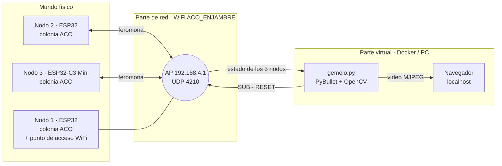

# Enjambre ACO con ESP32 y Gemelo Digital en PyBullet — Actividad 7


| Autor | Actividad | Herramientas |
|---|---|---|
| Johan Andrés Canchala Arenas ([@Johan-C777](https://github.com/Johan-C777)) | Actividad 7 | Arduino (ESP32 / ESP32-C3) · C++ · Python · PyBullet · OpenCV · Docker |

Tres nodos ESP32 (los "carritos") buscan la **ruta óptima** desde un punto **A** hasta la **meta M** en un laberinto tipo almacén. Cada nodo corre su propio **algoritmo de colonia de hormigas (ACO)**, y los tres **intercambian feromona por WiFi**. Un **gemelo digital en PyBullet** recibe esos datos en tiempo real y los replica con 3 robots virtuales que recorren el mismo laberinto.

[](https://videotourl.com/videos/1791333278707-1f90014d-8c21-4f06-b696-fac111d54d1b.mp4)

---

## 📑 Contenido

1. [Enunciado y cumplimiento](#-enunciado-y-cumplimiento)
2. [Arquitectura](#-arquitectura)
3. [Estructura del repositorio](#-estructura-del-repositorio)
4. [Requisitos](#-requisitos)
5. [Paso a paso de ejecución](#-paso-a-paso-de-ejecución)
6. [Explicación del código](#-explicación-del-código)
7. [Protocolo de red](#-protocolo-de-red)
8. [Análisis del algoritmo](#-análisis-del-algoritmo)
9. [Problemas encontrados y soluciones](#-problemas-encontrados-y-soluciones)
10. [Evidencias](#-evidencias)
11. [Solución de problemas](#-solución-de-problemas)
12. [Referencias](#-referencias)

---

## 📋 Enunciado y cumplimiento

> *"Tres carritos físicos (o nodos ESP32) deben encontrar la ruta óptima desde un punto A hasta una meta en un laberinto/almacén. El algoritmo de optimización por colonia de hormigas (ACO) corre dentro de cada ESP32, intercambian feromonas por red, y el resultado se refleja en una simulación PyBullet donde 3 robots virtuales replican el comportamiento."*

| Bloque del enunciado | Cómo se cumple |
|---|---|
| **Mundo físico:** 3 nodos ESP32 | 2 ESP32 DevKit + 1 ESP32-C3 Mini. Cada uno ejecuta su propia colonia de 6 hormigas cada 600 ms (`aco.h`). |
| **ACO dentro de cada ESP32** | Toda la búsqueda corre en el microcontrolador: recorrido de las hormigas, evaporación, depósito y refuerzo de la mejor ruta. El PC no calcula nada para los nodos. |
| **Intercambio de feromonas por red** | Cada nodo envía su matriz de feromona y su mejor ruta por UDP; los demás la mezclan con la propia. |
| **Parte de red: ESP en modo AP** | El nodo 1 crea la red WiFi `ACO_ENJAMBRE` (modo AP) y reenvía los mensajes entre los nodos y hacia el PC. |
| **Parte virtual: PyBullet + Docker** | `gemelo.py` muestra el laberinto, 3 carritos que siguen la ruta preferida de cada nodo y un mapa de calor de la feromona. Se empaqueta con el `Dockerfile` incluido. |

---

## 🧩 Arquitectura



- **Topología en estrella.** El nodo 1 es a la vez colonia de hormigas y concentrador: recibe el paquete de cada nodo y lo reenvía a los otros dos y al gemelo digital. Con esto no hace falta depender de que el AP retransmita *broadcasts* entre estaciones.
- **El gemelo se suscribe.** El PC envía `SUB` al nodo 1 cada segundo y recibe las respuestas por la misma ruta. Como la conexión la inicia el gemelo, funciona también desde dentro de Docker, donde las conexiones entrantes no llegan directamente.

---

## 📂 Estructura del repositorio

```text
Enjambre-ACO-ESP32-Gemelo-Digital/
├── Nodo1_ESP32_AP/
│   ├── Nodo1_ESP32_AP.ino     # ESP32: crea la red (AP), concentra y reenvía + su colonia
│   └── aco.h                  # Núcleo del algoritmo ACO (idéntico en los 3 nodos)
├── Nodo2_ESP32/
│   ├── Nodo2_ESP32.ino        # ESP32: se conecta a la red + su colonia
│   └── aco.h
├── Nodo3_ESP32C3/
│   ├── Nodo3_ESP32C3.ino      # ESP32-C3 Mini: se conecta a la red + su colonia
│   └── aco.h
├── gemelo/
│   ├── gemelo.py              # Gemelo digital: PyBullet + panel OpenCV + video web
│   ├── Dockerfile             # Imagen Docker del gemelo
│   └── requirements.txt
├── Montaje.jpg                # Foto de los 3 nodos
└── README.md
```

---

## 📦 Requisitos

| Parte | Necesario |
|---|---|
| Nodos | 2 × ESP32 DevKit, 1 × ESP32-C3 Mini y cables USB de datos |
| Firmware | Arduino IDE con el paquete de placas **esp32 de Espressif**. No requiere librerías externas. |
| Gemelo (con Python) | Python 3.10 u 11 con `pybullet`, `numpy` y `opencv-python` |
| Gemelo (con Docker) | Docker Desktop |

---

## 🚀 Paso a paso de ejecución

### 1. Cargar el firmware

| Nodo | Carpeta | Placa en Arduino IDE | Ajuste extra |
|---|---|---|---|
| 1 | `Nodo1_ESP32_AP` | ESP32 Dev Module | — |
| 2 | `Nodo2_ESP32` | ESP32 Dev Module | — |
| 3 | `Nodo3_ESP32C3` | ESP32C3 Dev Module | **USB CDC On Boot: Disabled** (la placa usa un chip CH340) |

Sube primero el **nodo 1**, porque es el que crea la red. En el Monitor Serie (115200 baudios) debe aparecer:

```text
[N1] Red 'ACO_ENJAMBRE' creada. IP del AP: 192.168.4.1
```

### 2. Comprobar el enjambre

Con los 3 nodos encendidos, cada nodo imprime una línea por iteración:

```text
[N1] it  37 | mejor: 16 pasos | preferida: 16 | en la mejor:  83% | llegan: 100% | vecinos: N2 OK N3 OK | CONVERGIDO
```

`vecinos: N2 OK N3 OK` confirma que los nodos están intercambiando feromona. El LED de las placas parpadea mientras la colonia busca y queda fijo cuando converge.

### 3. Ejecutar el gemelo digital

1. Conecta el PC a la red WiFi **`ACO_ENJAMBRE`** (clave `hormigas123`). Windows indicará "Sin internet"; es normal.
2. Ejecuta el gemelo, con Python o con Docker:

   **Opción A · Python** (la usada en el video):

   ```powershell
   cd gemelo
   $env:PUERTO_WEB = "5050"
   python gemelo.py
   ```

   **Opción B · Docker:**

   ```powershell
   cd gemelo
   docker build -t gemelo-aco .
   docker run --rm -p 5050:8080 gemelo-aco
   ```

3. Abre **http://localhost:5050** en el navegador.

> [!TIP]
> Para probar el gemelo sin las placas, agrega `--simular`. En ese modo, las 3 colonias se simulan en el PC con el mismo algoritmo: `python gemelo.py --simular`.

### 4. Repetir la búsqueda

El botón **Reiniciar enjambre** de la página, o el botón **BOOT** de cualquier placa, reinicia las 3 colonias. Así se ve otra vez la búsqueda desde cero.

### Cómo saber que funciona

| Indicador | Correcto |
|---|---|
| Título del panel | `Enjambre ACO - ESP32 reales (AP 192.168.4.1)` |
| Filas N1, N2, N3 | El número de iteración aumenta; ninguna dice "sin senal" |
| Línea inferior | `Buscando... (3/3 nodos en linea, N paquetes)` y luego **`ENJAMBRE DE ACUERDO: ruta optima de 16 pasos`** |
| Escena 3D | El camino óptimo se vuelve rojo y los 3 carritos lo recorren |
| Placas | Los LEDs pasan de parpadear a quedar fijos |

---

## 🔍 Explicación del código

### `aco.h` — núcleo del algoritmo (C++ puro, igual en los 3 nodos)

| Elemento | Qué hace |
|---|---|
| `LABERINTO` | Mapa de 13 × 9 celdas (`#` pared, `.` pasillo, `A` inicio, `M` meta). Se convierte en un grafo de 50 nodos y 52 aristas. |
| `Colonia::iniciar()` | Construye el grafo, la heurística y siembra el generador aleatorio con `esp_random()`. Así cada nodo explora distinto. |
| `caminar()` | Una hormiga avanza desde A eligiendo el siguiente pasillo con probabilidad proporcional a feromona × heurística, sin repetir celdas. Si queda atrapada en un callejón, muere. |
| `iterar()` | 6 hormigas buscan; luego se evapora la feromona, cada hormiga que llegó deposita, y se refuerza la mejor ruta conocida (elitismo). |
| `calcularPreferida()` | La ruta que hoy seguiría un carrito: en cada cruce toma el pasillo con más feromona. Es la que replica el gemelo. |
| `mezclar()` | Combina la feromona recibida de otro nodo y adopta su mejor ruta si es más corta. Antes valida que la ruta sea real (empieza en A, termina en M y todas sus celdas son vecinas). |
| `empaquetar()` | Arma el paquete de red de 303 bytes. |

### `NodoX.ino` — firmware de cada placa

Los tres sketches son iguales salvo `#define NODO_ID`:

| Bloque | Qué hace |
|---|---|
| WiFi | El nodo 1 crea el AP `ACO_ENJAMBRE` (canal 6, hasta 4 clientes). Los nodos 2 y 3 se conectan como estaciones con reconexión automática. En el C3 se reduce la potencia de transmisión, porque muchas placas C3 pequeñas no se conectan a potencia máxima. |
| Bucle de iteración | Cada 600 ms: `iterar()` → enviar estado → imprimir estado. La colonia sigue corriendo aunque se pierda la red. |
| `procesarEntrada()` | Lee los paquetes UDP: `SUB` (suscripción del gemelo), `RESET` (reinicio) o el paquete de feromona de otro nodo, que se mezcla con la colonia local. |
| Concentrador (solo nodo 1) | Guarda las direcciones de los nodos y del gemelo. Reenvía cada paquete a todos excepto a quien lo envió, y olvida las direcciones que llevan 10 s sin hablar. |
| Botón BOOT | Reinicia la búsqueda en todo el enjambre. |
| LED | Parpadea mientras la colonia busca y queda fijo cuando converge. |

### `gemelo.py` — gemelo digital

| Clase / función | Qué hace |
|---|---|
| `RedUDP` | Se suscribe al nodo 1 y recibe los paquetes de los 3 nodos. Valida tamaño, cabecera, versión y número de aristas. |
| `Simulador` | Modo `--simular`: las 3 colonias en Python con el mismo algoritmo y los mismos parámetros que `aco.h`. |
| `Escena` | Construye en PyBullet las paredes, las baldosas, la bandera de meta y 3 carritos (rojo N1, azul N2, verde N3). Pinta las baldosas según la feromona promedio de los 3 nodos. |
| `Carrito` | Recorre la ruta preferida de su nodo desde A, con giro suave en las esquinas. Al terminar espera y sale de nuevo con la ruta más reciente; así se ve cómo cada colonia va aprendiendo. |
| `panel()` | Vista 2D en OpenCV: feromona de cada pasillo (color y grosor), ruta preferida de cada nodo y estado de cada uno. |
| `Manejador` | Servidor web: `/` (página), `/stream` (video MJPEG), `/reset` (reinicia el enjambre) y `/estado` (JSON). |

---

## 📡 Protocolo de red

Todo viaja por **UDP, puerto 4210**, en la red `ACO_ENJAMBRE` (AP en `192.168.4.1`).

| Mensaje | Origen → destino | Contenido |
|---|---|---|
| `SUB` | Gemelo → nodo 1 | Suscripción (cada 1 s) |
| `RESET` | Gemelo o botón BOOT → nodo 1 → todos | Reiniciar las colonias |
| Paquete de estado | Cada nodo → nodo 1 → demás nodos y gemelo | 303 bytes, ver tabla |

**Paquete de estado (`struct Paquete`, little-endian, 303 bytes):**

| Campo | Tipo | Descripción |
|---|---|---|
| `magia` | 2 × char | `"AC"` |
| `version`, `tipo`, `nodo` | uint8 | 1, 1 (estado), 1..3 |
| `convergido` | uint8 | 0 = buscando, 1 = convergido |
| `iteracion` | uint16 | Iteraciones de la colonia |
| `mejorLargo` | uint16 | Pasos de la mejor ruta (`0xFFFF` = ninguna) |
| `exitoPct`, `enMejorPct` | uint8 | % de hormigas que llegaron a la meta y % que siguieron la mejor ruta |
| `nAristas`, `largoMejor`, `largoPreferida` | uint8 | 52 aristas; largo de las rutas en celdas |
| `tau[64]` | uint16 | Feromona de cada arista × 1000 |
| `mejor[80]`, `preferida[80]` | uint8 | Rutas como índices de celda (`fila·13 + columna`) |

---

## 📈 Análisis del algoritmo

### Laberinto

Mapa de 13 × 9 celdas, con 50 pasillos y 52 conexiones. Desde A hasta M existen **8 rutas simples**, de 16, 20, 20, 24, 24, 28, 28 y 32 pasos, más varios callejones sin salida. La ruta óptima es **única: 16 pasos**.

### Reglas de la colonia

**Elección del siguiente pasillo.** Una hormiga en la celda $i$ elige la celda vecina $j$, entre las no visitadas $N_i$, con probabilidad:

$$
p_{ij} = \frac{\tau_{ij}^{\,\alpha}\,\eta_j^{\,\beta}}{\sum_{l \in N_i} \tau_{il}^{\,\alpha}\,\eta_l^{\,\beta}},
\qquad
\eta_j = \frac{1}{1 + |f_j - f_M| + |c_j - c_M|}
$$

La heurística $\eta$ (cercanía en línea recta a la meta) **engaña** en un laberinto: acercarse a M en línea recta suele llevar a un callejón. Por eso tiene poco peso ($\beta = 0.5$) y la que decide es la feromona.

**Actualización de la feromona después de cada iteración:**

$$
\tau_{ij} \leftarrow (1-\rho)\,\tau_{ij} \;+\; \sum_{k \,\in\, \text{llegaron}} \frac{Q}{L_k} \;+\; e\,\frac{Q}{L_{mejor}},
\qquad \tau_{ij} \in [\tau_{min},\ \tau_{max}]
$$

La evaporación $\rho$ olvida las rutas malas. El depósito $Q/L$ favorece las rutas cortas, y el término elitista $e$ refuerza la mejor ruta conocida. Los límites $[\tau_{min}, \tau_{max}]$, al estilo MAX–MIN Ant System, evitan que una ruta acapare toda la feromona antes de tiempo.

**Intercambio entre nodos.** Al recibir la feromona $\tau^{(r)}$ de otro nodo:

$$
\tau_{ij} \leftarrow (1-w)\,\tau_{ij} + w\,\tau^{(r)}_{ij}
$$

Además, si el otro nodo trae una ruta más corta (y válida), se adopta como mejor ruta.

**Convergencia.** Un nodo se declara convergido cuando se cumplen tres condiciones: su mejor ruta lleva 10 iteraciones sin mejorar, al menos el 75 % de las hormigas la siguen y su ruta preferida coincide con ella. Desde ese momento se mantiene convergido hasta que aparezca una ruta mejor; así el LED y el estado no titilan.

| Parámetro | Valor | Parámetro | Valor |
|---|---|---|---|
| Hormigas por iteración | 6 | Evaporación $\rho$ | 0.15 |
| $\alpha$ (peso feromona) | 1.0 | Depósito $Q$ | 4 |
| $\beta$ (peso heurística) | 0.5 | Elitismo $e$ | 2 |
| $\tau_0$, $\tau_{min}$, $\tau_{max}$ | 1.0, 0.05, 5.0 | Mezcla $w$ | 0.25 |
| Periodo de iteración | 600 ms | Convergencia | 10 it. estables y 75 % |

### Resultados: ¿sirve compartir feromona?

`aco.h` se compiló y se ejecutó en el PC con **300 enjambres de 3 colonias**, cada uno con semillas aleatorias distintas. El criterio de éxito fue que los 3 nodos convergieran con su ruta preferida igual a la óptima (16 pasos):

| Modo | Llegaron al óptimo | Iteraciones (promedio) | Peor caso |
|---|---|---|---|
| **Con intercambio de feromona** | 300 / 300 | **15.8** (≈ 9.5 s) | **29** (≈ 17 s) |
| Sin intercambio (colonias aisladas) | 300 / 300 | 28.5 | 200 |

Compartir feromona hace al enjambre **casi el doble de rápido en promedio** y, sobre todo, elimina los casos lentos: el peor caso baja de 200 a 29 iteraciones. Una colonia que se "atasca" explorando una ruta larga recibe la información de las otras y corrige.

### Validación del enlace

- El gemelo y el firmware usan el mismo orden de aristas (52/52) y el mismo formato de paquete.
- Un paquete binario generado por `aco.h` se decodificó en Python con exactamente los mismos valores.
- En una prueba con un concentrador simulado, el gemelo recibió **120 de 120** paquetes, descartó uno basura y envió correctamente la orden `RESET`.
- El simulador de Python converge igual que el C++: 20.8 iteraciones en promedio frente a 20.9.

---

## 🔧 Problemas encontrados y soluciones

| Síntoma | Causa | Solución |
|---|---|---|
| `docker : El término 'docker' no se reconoce` | Docker no estaba instalado en el PC | Ejecutar el mismo `gemelo.py` directo con Python; el `Dockerfile` queda listo para cuando se instale Docker Desktop |
| `PermissionError: [WinError 10013]` al abrir la página | Windows tenía el puerto 8080 ocupado o reservado | Cambiar de puerto con la variable `PUERTO_WEB=5050`, sin editar el código |
| Solo se veía 1 carrito de 3 | El carrito verde se camuflaba en la baldosa de inicio verde; las paredes altas y la cámara lateral tapaban los pasillos; y los carritos iban en fila, casi encima | Baldosa de inicio cian, paredes más bajas, cámara casi cenital, carritos lado a lado y con 1 s entre salidas |
| El LED y el estado titilaban entre "buscando" y "convergido" | Por azar, el % de hormigas en la mejor ruta sube y baja en cada iteración | Convergencia con memoria: se mantiene hasta que aparezca una ruta mejor |
| La búsqueda casi no se veía | Con mucho peso a la heurística, las hormigas encontraban la ruta en la primera iteración | $\beta = 0.5$ y 6 hormigas, elegidos tras comparar varias combinaciones: ahora se ve explorar y converger |
| El gemelo no recibiría datos dentro de Docker | Las conexiones entrantes no llegan al contenedor | El gemelo se suscribe (`SUB`) y recibe las respuestas por la misma ruta |
| Riesgo de que los nodos no se vean entre ellos | Depender de que el AP retransmita *broadcasts* entre estaciones | Topología en estrella: el nodo 1 reenvía cada paquete |

---

## 🎥 Evidencias

<p align="center"></p>

[](https://videotourl.com/videos/1791333278707-1f90014d-8c21-4f06-b696-fac111d54d1b.mp4)

En el video se ven las 3 placas encendidas y el gemelo en modo "ESP32 reales". Tras reiniciar el enjambre, los 3 carritos exploran, el camino óptimo se vuelve rojo y el panel termina en **"ENJAMBRE DE ACUERDO: ruta óptima de 16 pasos"**.

---

## 🧯 Solución de problemas

| Problema | Qué revisar |
|---|---|
| El panel dice "Esperando nodos" | Que el PC esté conectado a `ACO_ENJAMBRE`, que el nodo 1 esté encendido y que el firewall de Windows permita Python en **redes públicas**. |
| Un nodo aparece "sin senal" | Reiniciar esa placa con EN/RST y verificar en su Monitor Serie que diga `Conectado. IP: 192.168.4.x`. |
| El nodo 3 (C3) no conecta al WiFi | Revisar que tenga el firmware de `Nodo3_ESP32C3`, que ya reduce la potencia de transmisión, y acercarlo al nodo 1. |
| No sale nada en el Monitor Serie del C3 | `USB CDC On Boot` debe estar en **Disabled**. |
| La página no abre | Probar otro puerto: `$env:PUERTO_WEB = "8765"`. |

---

## 📚 Referencias

- M. Dorigo y T. Stützle, *Ant Colony Optimization*, MIT Press, 2004.
- T. Stützle y H. H. Hoos, "MAX–MIN Ant System", *Future Generation Computer Systems*, vol. 16, n.º 8, pp. 889–914, 2000.
- [PyBullet Quickstart Guide](https://pybullet.org/wordpress/).
- [Espressif · Arduino Core para ESP32 (WiFi, modo AP y UDP)](https://github.com/espressif/arduino-esp32).
